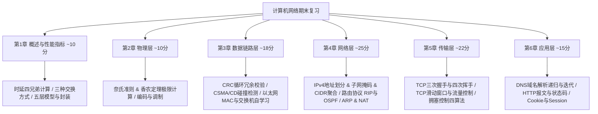

# 计算机网络期末冲刺复习总纲（谢希仁五层体系）

> **备考定位**：面向零基础速成，1~2 周冲刺，直击高频考点、必考计算题与核心综合大题。

---

## 知识框架与章节分值权重分布

---

## 复习推进路线图

| 阶段 | 章节 | 核心掌握目标 | 必拿分题型 |
|:---|:---|:---|:---|
| **第1站** | **第1章 概述** | 三种交换方式、时延计算公式（发送时延 vs 传播时延）、五层架构封装过程 | 单选题、填空题、时延计算小题 |
| **第2站** | **第2章 物理层** | 奈奎斯特准则（奈氏准则）、香农公式（信道极限容量计算）、编码与调制机制 | 经典计算小题（极限速率对比） |
| **第3站** | **第3章 数据链路层** | 封装成帧/透明传输/差错检测、CRC 校验码计算、CSMA/CD 最短帧长公式、交换机自学习算法 | CRC 计算大题、CSMA/CD 计算与分析 |
| **第4站** | **第4章 网络层（核心重头）** | IP 地址分类与子网划分、CIDR 路由汇聚、ARP 协议工作过程、RIP/OSPF/BGP、NAT 与路由器转发流程 | 必考大题：子网划分与路由表匹配 |
| **第5站** | **第5章 传输层（核心重头）** | UDP 与 TCP 差异、TCP 三次握手与四次挥手状态机、滑动窗口、拥塞控制（慢开始/拥塞避免/快重传/快恢复） | 必考大题：TCP 连接过程时序图、拥塞窗口推演图 |
| **第6站** | **第6章 应用层** | DNS 迭代与递归查询时序、HTTP 请求/响应方法与常见状态码、Persistent 连接 | 综合分析简答、选择题 |

---

## 零基础冲刺原则

1. **先生活比喻，再学术概念**：不强塞抽象术语，全用“寄快递、打电话、修公路、开水龙头”直观还原。
2. **每小节必配 1~2 道单选题/微计算**：学完即测，当场检验。
3. **直击得分点，不做无效展开**：弱化历史背景与冷门过时硬件，把时间聚焦在试卷 80% 的高频分值上。

